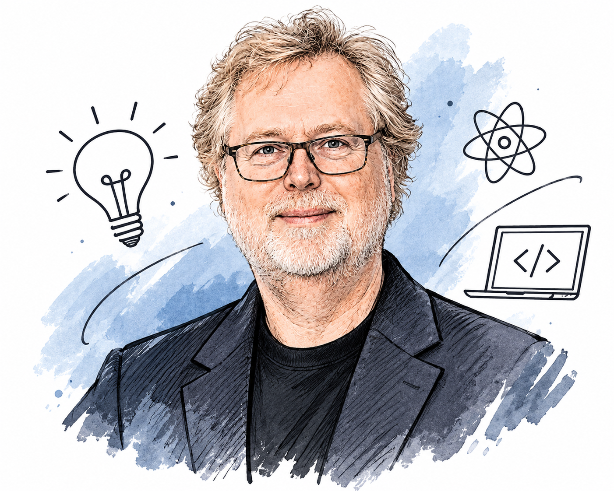

<!-- 🔴 RED HEADER MENU ROW -->

  

    

      
V

      Visionary Founder
    

    <nav style="display: flex; align-items: center; gap: 40px;">
      <a href="/" style="text-decoration: none; color: #F3EFE0; font-weight: 600; font-size: 0.95em; opacity: 0.85;">Home</a>
      <a href="/about" style="text-decoration: none; color: #F3EFE0; font-weight: 600; font-size: 0.95em; opacity: 0.85;">About Me</a>
      <a href="/disclaimer" style="text-decoration: none; color: #F3EFE0; font-weight: 600; font-size: 0.95em; opacity: 0.85;">Disclaimer</a>
      <a href="/none-of-your-business" style="text-decoration: none; color: #F3EFE0; font-weight: 600; font-size: 0.95em; opacity: 0.85;">None of Your Business</a>
      <a href="mailto:worksharma811@gmail.com" style="text-decoration: none; background: #F3EFE0; color: #D72631; padding: 10px 22px; border-radius: 30px; font-weight: 700; font-size: 0.95em; border: 1px solid #1A1A1A;">Sign Up</a>
    </nav>
  

  

    Polymath Mindset & AI Survival
    <h1 style="font-size: 2.5em; font-weight: 800; margin: 15px 0 0 0; letter-spacing: -1px; line-height: 1.3; color: #F3EFE0;">In an AI World, Only This Man Can Save You... (Nathan Myhrvold) 🧠🎶</h1>
  

<!-- 🔴 ULTRA-PREMIUM WHITE CANVAS CONTAINER -->

  <!-- DOPAMINE CHUNK TEXT WRAPPER LAYER -->
  

    
    
Everywhere you turn your face right now, you are hit with the exact same exhausting headline.

    
    
<em>AI will take your job. Finance is automated. Coding is over.</em>

    
    
When you are a student trying to figure out your future, that constant noise feels heavy. Honestly, it feels overwhelming even for seasoned professionals who have spent twenty years climbing the corporate ladder.

    
    
When everyone is panicking about machines replacing human workers, people keep asking what skill is actually left for us. The answer isn't memorizing more textbook rules or learning how to type faster than an algorithm.

    
    
Okay, fine—I admit saying <em>"only this man can save you"</em> sounds a little dramatic. But when I watched the documentary <em>The Creative Brain</em>, I found the exact human blueprint we need to survive this AI era.

    
    
His name is <strong>Nathan Myhrvold</strong>.

    <h3>The Physicist Who Put Centrifuges in the Kitchen</h3>
        <!-- AI-GENERATED ILLUSTRATED PORTRAIT -->
    

      
      

        AI-generated illustrated portrait
      

    

    
If you haven't heard of Nathan Myhrvold, his resume looks like five completely different people lived inside one lifetime.

    
    
He is a theoretical physicist, a prolific inventor with hundreds of patents, a former Chief Technology Officer at Microsoft, a wildlife photographer, and a trained chef.

    
    
What made him my absolute favorite figure in that documentary was how he approached cooking. He didn't just follow traditional grandma recipes or standard culinary school rules.

    
    
He built a massive food lab and used hard physics, ultrasonic waves, and industrial centrifuges to completely reinvent how humans understand and cook food.

    
    
He proved a truth that AI simply cannot touch: <strong>groundbreaking creativity happens when you force completely unrelated worlds to collide.</strong>

    <h3>Living Inside an ADHD Polymath Brain</h3>
    
    
I fell in love with his story because my own brain refuses to sit quietly inside one neat little career box.

    
    
If you look at my daily life right now, it looks like pure organized chaos:

    
    <ul>
      <li><strong>The Numbers & Logic:</strong> I am studying <strong>ACCA accounting</strong> while navigating 12th-grade engineering concepts.</li>
      <li><strong>The Tech Rebellion:</strong> I am building my own <strong>SaaS software startup</strong> from scratch using AI tools and learning how code works behind the scenes.</li>
      <li><strong>The Creative Escape:</strong> I am obsessed with photography, dreaming about directing my own movie, learning how to write songs, and practicing the <strong>flute</strong>.</li>
    </ul>
    
    
Traditional society looks at a list like that and labels it "unfocused." When you have an ADHD brain, people constantly pressure you to drop the weird hobbies, pick one "safe" lane, and stay there forever.

    
    
For a long time, trying random passions for a day or jumping from ledgers to music felt like a contradiction. Now, I realize those contradictions are my greatest unfair advantage.

    <h3>The Flute: Learning That Words Are Not Enough</h3>
    
    
When you spend your mornings staring at strict accounting standards and technical engineering formulas, you start believing that everything in life can be controlled through logic, rules, and sharp words.

    
    
Picking up the flute shattered that illusion for me.

    
    
You cannot bully a flute into making a good sound. You cannot argue with it, and you cannot force it with aggressive effort.

    
    
Learning the flute gave me a quiet kind of confidence. It taught me that <strong>everything cannot be controlled by words alone—sometimes, just steady, patient breath is enough.</strong>

    
    
When you bring that exact calmness back to building a startup or studying a brutal exam syllabus, you stop panicking when things don't work on the first try.

    <h3>Photography vs. Accounting: The Pencil and the Pen</h3>
    
    
The sharpest contrast in my polymath life sits right between my camera lens and my accounting notebook.

    
    
In accounting, there is a strict, unforgiving rule: you must be precise enough to write clean journal entries and not mess them up. Every debit needs its exact credit. Every figure has to sit in its proper column.

    
    
Accounting is like a child holding a <strong>pen</strong>. Every mark you make is exact, deliberate, and permanent. If you spill ink on the ledger, everyone sees the mistake.

    
    
Photography is pure, unfiltered rebellion against that stiffness.

    
    
When you hold a camera, you snap a quick shot of a fleeting moment that will never happen the exact same way again. Yet once it is captured, you have total freedom.

    
    
Photography is like a child holding a <strong>pencil</strong>. You can sketch freely, blur the background on purpose, make wild mistakes, have fun, erase the lines, and hit delete without anyone auditing your work.

    
    
<em>(Ahem—for the record, I am not funded by any secret organization to ruin the reputation of accounting! I respect the pen, even when my brain craves the pencil.)</em>

    <h3>Music: Becoming the CEO of Your Own Universe</h3>
    
    
Then there is music and songwriting—which is honestly a portal into another dimension.

    
    
When you are writing lyrics or losing yourself in a melody, you aren't sitting at a desk checking someone else's tax liabilities or auditing a company's balance sheet.

    
    
In music, <strong>you are the main hero and the CEO of the entire universe.</strong>

    
    
There is a fascinating psychological truth about human beings: our brains actually do not know the difference between vivid imagination and physical reality.

    
    
When you imagine yourself leading a massive creative vision, directing a film, or launching a global software product, your brain fires the exact same confidence signals as if it were already happening. So my rule is simple: enjoy that creative high for as long as it lasts, humans.

    <h3>Why Connecting Weird Dots Is the Dream Job of the Future</h3>
    
    
Here is why Nathan Myhrvold's polymath approach beats artificial intelligence every single time.

    
    
AI is incredible at staying inside one box and remixing patterns that already exist. It can generate standard code or summarize a tax law in three seconds flat.

    
    
What AI cannot do is try a weird, random passion for a single afternoon, fail miserably at it, and suddenly connect that strange experience to solve a business problem six months later.

    
    
Real human creativity lives in the messy space between different worlds—like using physics to cook a steak, or using a K-Drama and a flute to understand corporate finance.

    
    
Honestly, I have a prediction about where the job market is heading. Once AI finishes automating all the boring, repetitive office work, companies are going to realize all their automated products look and sound identical.

    
