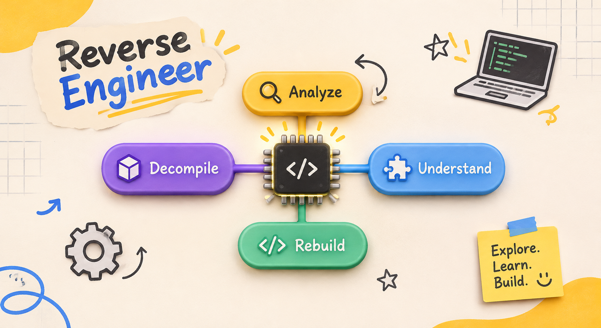

<!-- 🔴 RED HEADER MENU ROW -->

  

    

      
V

      Visionary Founder
    

    <nav style="display: flex; align-items: center; gap: 40px;">
      <a href="/" style="text-decoration: none; color: #F3EFE0; font-weight: 600; font-size: 0.95em; opacity: 0.85;">Home</a>
      <a href="/about" style="text-decoration: none; color: #F3EFE0; font-weight: 600; font-size: 0.95em; opacity: 0.85;">About Me</a>
      <a href="/disclaimer" style="text-decoration: none; color: #F3EFE0; font-weight: 600; font-size: 0.95em; opacity: 0.85;">Disclaimer</a>
      <a href="/none-of-your-business" style="text-decoration: none; color: #F3EFE0; font-weight: 600; font-size: 0.95em; opacity: 0.85;">None of Your Business</a>
      <a href="mailto:worksharma811@gmail.com" style="text-decoration: none; background: #F3EFE0; color: #D72631; padding: 10px 22px; border-radius: 30px; font-weight: 700; font-size: 0.95em; border: 1px solid #1A1A1A;">Sign Up</a>
    </nav>
  

  

    SaaS & Accounting Reality
    <h1 style="font-size: 2.5em; font-weight: 800; margin: 15px 0 0 0; letter-spacing: -1px; line-height: 1.3; color: #F3EFE0;">Steve Jobs, Jalebis, and Why Solo Founders Crash Without Cash Flow 🍏🥨</h1>
  

<!-- 🔴 ULTRA-PREMIUM WHITE CANVAS CONTAINER -->

  <!-- DOPAMINE CHUNK TEXT WRAPPER LAYER -->
  

    
    
Everywhere you scroll right now, the internet is screaming the exact same panic.

    
    
AI is taking over finance jobs. Software engineering is dead. Everything feels overwhelming—not just for students like me, but even for seasoned professionals who have been in the game for decades.

    
    
Honestly, building a SaaS project from scratch on a zero-dollar student budget feels like pure rebellion right now. And let's be honest about the biggest contradiction on the internet: everyone publicly claims they hate AI, yet we all secretly use it behind closed doors to handle the boring, repetitive tasks.

    <!-- IMAGE 1 -->
    

      
    

    <h3>Stop Hiding Behind 1,000 Lines of Code</h3>
    
    
No disrespect or controversy toward hardcore software developers, <strong>but for years, people were hiding behind code.</strong>

    
    
If you wanted to bring a simple creative feature into the world, you had to memorize complex syntax and write 1,000 lines of code just to make a button work. Turning an idea into reality was expensive, slow, and exhausting.

    
    
Today, AI writes the basic syntax. Building is easier than ever, which means uniqueness is harder than ever.

    
    
You can no longer hide behind thousands of lines of code. Everyone has access to the exact same tools, which gently forces us to rely on <strong>100% raw human creativity</strong>—our personal environment, our weird contradictions, and our own execution—to stand out.

    <!-- IMAGE 2 -->
    

      
    

    <h3>The "Jalebi" Perspective Trap</h3>
    
    
This is where Steve Jobs' most famous quote hits different: <em>"People don't know what they want until you show it to them."</em>

    
    
When I am building a software tool, asking people for their opinion before I build it is like putting an axe on my own foot.

    
    
Why? Because human thinking is twisted like a <strong>Jalebi</strong>. Everyone judges your brand-new idea from inside their own tiny, limited circle of what already exists.

    
    
If you ask ten people for feedback on something truly original, they will pull it apart using their own limited perspective. Chasing validation from people will ruin your startup faster than your ex.

    
    
People remain trapped in their limited thinking until a hero—male or female, because we do gender equality around here—steps up and shamelessly shows them the finished product.

    <!-- IMAGE 3 -->
    

      
    

    <h3>Reverse Engineering Reality vs. ACCA Rules</h3>
    
    
To build something people have never seen before, you have to break down how things actually work—analyze the pieces, decompile the problem, understand the logic, and rebuild it your own way.

    <!-- IMAGE 4: YOUR CUSTOM REVERSE ENGINEER GRAPHIC -->
    

      
    

    
You can be creative with your product, <strong>but you cannot reverse-engineer accounting rules to fit your mood.</strong>

    
    
In my <strong>ACCA FA1</strong> studies, accounting isn't twisted like a Jalebi. You cannot perceive a debit or credit according to your personal perspective. The math is cold and absolute.

    
    
And let's drop the fake modesty about money. Steve Jobs famously claimed he never did it for the money. Let's be real: we are building ventures to make money, and there is nothing wrong with wanting to get paid.

    <h3>The Cash Flow & Liquidity Reality Check</h3>
    
    
When you follow Steve Jobs' "build first, show them later" philosophy, you walk straight into a brutal financial trap.

    
    
Because nobody asked for your radical new product, nobody is lined up with a credit card on Day 1. Your <strong>Revenue</strong> sits at zero while the world slowly figures out what you built.

    
    
Meanwhile, your <strong>Expenses</strong> start immediately. In accounting, survival comes down to one critical concept: <strong>Liquidity</strong>.

    
    <ul>
      <li><strong>Your Product is an Asset:</strong> You spend all your time, creativity, and money building a brilliant app. On paper, your business owns a valuable asset.</li>
      <li><strong>Your Cash is Oxygen:</strong> Tomorrow morning, a server bill or tool subscription arrives. You cannot pay that bill with a piece of your app's code. You need actual, liquid cash in your bank account.</li>
    </ul>

    <h3>The Rebel Accountant Rule</h3>
    
    
If your cash balance hits zero while you wait for customers to understand your vision, your startup is <strong>illiquid</strong>. Even if your idea is worth millions in the future, your business dies today because you cannot pay the daily bills.

    
    
To win as a solo founder, you have to split your brain in two.

    
    
Let your creative side dream like Steve Jobs—ignore the Jalebi opinions, refuse to hide behind code, and shamelessly build something unique. But every single week, let your inner ACCA student audit the cash ledger so your rebellion actually survives long enough to get paid.

  

